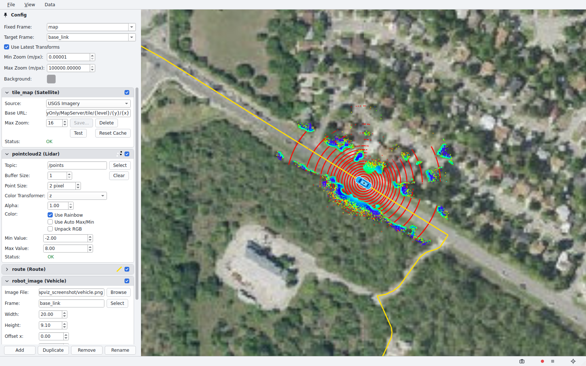

Mapviz
======

Mapviz is a [ROS](http://www.ros.org/) based visualization tool with a plug-in system similar to [RViz](https://github.com/ros2/rviz) focused on visualizing 2D data.



Usage
-----

[View the documentation](https://swri-robotics.github.io/mapviz/) for usage information.

Carto API Key
-----
The Tile Map plugin's default `Carto` source requires an API key.

1. Sign up or log in at [carto.com/basemaps/apikey](https://carto.com/basemaps/apikey) and create a key. Note there are limits on non-commercial vs. commercial usage.
2. In the Tile Map plugin, select `Carto` as the source, paste the key into the `Carto API Key` field and click `Save`.
3. Save the Mapviz config to keep the key; it is stored as `carto_api_key`, e.g.

   ```yaml
   - type: mapviz_plugins/tile_map
     config:
       carto_api_key: "<your key>"
       source: Carto
   ```

v4.0.0 Special Note
-----
v4.0.0 introduced several breaking changes.

- Many header files had their extensions changed from `.h` to `.hpp` to conform to ROS conventions.
- The UI and ROS callbacks were split into separate threads. This significantly impacts the plugin architecture. Please see the documentation for instructions on how to safely apply these changes and for examples of plugins that use the new architecture.

Plugins
-----
Mapviz comes with these plugins.

Plugin | Subscribes to | Description
:--- | :--- | :---
`attitude_indicator` | `geometry_msgs/Pose`<br>`nav_msgs/Odometry`<br>`sensor_msgs/Imu` | Shows the vehicle's roll, pitch, and heading on an aircraft-style attitude indicator.
`coordinate_picker` | None | Converts the points you click into a frame of your choice, lists them, and copies the latest one to the clipboard.
`disparity` | `stereo_msgs/DisparityImage` | Shows a stereo disparity image over the map.
`draw_marker` | None | Lets you draw points, lines, or polygons on the map and publishes them as a `visualization_msgs/Marker`.
`draw_polygon` | None | Lets you draw a polygon on the map and publishes it as a `geometry_msgs/PolygonStamped`.
`float` | `std_msgs/Float32`<br>`std_msgs/Float64`<br>`marti_common_msgs/Float32Stamped`<br>`marti_common_msgs/Float64Stamped`<br>`marti_sensor_msgs/Velocity` | Shows the latest number from a topic as text at a fixed spot on the map.
`gps` | `gps_msgs/GPSFix` | Plots GPS fixes on the map as points, lines, or arrows.
`grid` | None | Draws a grid of evenly spaced lines over the map.
`image` | `sensor_msgs/Image` | Shows a camera image at a chosen spot on the map view.
`laserscan` | `sensor_msgs/LaserScan` | Draws laser scan returns, colored by intensity, range, or position.
`marker` | `visualization_msgs/Marker`<br>`visualization_msgs/MarkerArray` | Draws RViz-style markers such as arrows, lines, shapes, and text.
`measuring` | None | Measures the distance between points you click on the map.
`move_base` | None | Lets you click on the map to set the robot's initial pose or send it a Nav2 navigation goal.
`multires_image` | None | Displays a large georeferenced image from disk.
`navsat` | `sensor_msgs/NavSatFix` | Plots GPS fixes from `NavSatFix` messages on the map.
`occupancy_grid` | `nav_msgs/OccupancyGrid`<br>`map_msgs/OccupancyGridUpdate` | Displays occupancy grid maps.
`odometry` | `nav_msgs/Odometry` | Draws the robot's position and heading from odometry, with an optional trail of past positions.
`path` | `nav_msgs/Path` | Draws a path as a line on the map.
`plan_route` | `marti_nav_msgs/PlanRoute` | Lets you click waypoints, asks a route planning service for a route through them, and publishes the result.
`point_click_publisher` | None | Publishes a `geometry_msgs/PointStamped` for every point you click on the map.
`pointcloud2` | `sensor_msgs/PointCloud2` | Draws point clouds from above, colored by a field such as height or intensity.
`pose` | `geometry_msgs/PoseStamped` | Draws a pose as an arrow, with an optional trail of past poses.
`robot_image` | None | Draws a picture of your robot from an image file.
`robot_model` | `std_msgs/String` | Draws a top-down view of the robot's URDF model.
`route` | `marti_nav_msgs/Route`<br>`marti_nav_msgs/RoutePosition` | Draws a route and the vehicle's current position along it.
`speedometer` | `nav_msgs/Odometry` | Shows the vehicle's speed on a dial.
`string` | `std_msgs/String`<br>`marti_common_msgs/StringStamped` | Shows the latest text message at a fixed spot on the map.
`textured_marker` | `marti_visualization_msgs/TexturedMarker`<br>`marti_visualization_msgs/TexturedMarkerArray` | Draws images that marker messages place on the map.
`tf_frame` | `tf` tree | Draws where a TF frame is, with an optional trail as it moves.
`tile_map` | None | Shows map or satellite imagery from tile servers such as OpenStreetMap, Carto, Stadia, Bing, or USGS.

Build Status
------

### Branches

&nbsp; | **Humble** | **Jazzy** | **Kilted** | **Lyrical** | **Rolling**
:--- | :---: | :---: | :---: | :---: | :---:
Branch | [`humble`](https://github.com/swri-robotics/mapviz/tree/ros2-devel) | [`jazzy`](https://github.com/swri-robotics/mapviz/tree/ros2-devel) | [`kilted`](https://github.com/swri-robotics/mapviz/tree/ros2-devel) | [`lyrical`](https://github.com/swri-robotics/mapviz/tree/ros2-devel) | [`rolling`](https://github.com/swri-robotics/mapviz/tree/ros2-devel)

### Released Versions

&nbsp; | **Humble** | **Jazzy** | **Kilted** | **Lyrical** | **Rolling**
:--- | :---: | :---: | :---: | :---: | :---:
Version | [](https://index.ros.org/r/mapviz/#humble) | [](https://index.ros.org/r/mapviz/#jazzy) | [](https://index.ros.org/r/mapviz/#kilted) | [](https://index.ros.org/r/mapviz/#lyrical) | [](https://index.ros.org/r/mapviz/#rolling)

### CI

&nbsp; | **Humble** | **Jazzy** | **Kilted** | **Lyrical** | **Rolling**
:--- | :---: | :---: | :---: | :---: | :---:
`testing` | [](https://github.com/swri-robotics/mapviz/blob/ros2-devel/.github/workflows/humble_testing.yml) | [](https://github.com/swri-robotics/mapviz/blob/ros2-devel/.github/workflows/jazzy_testing.yml) | [](https://github.com/swri-robotics/mapviz/blob/ros2-devel/.github/workflows/kilted_testing.yml) | [](https://github.com/swri-robotics/mapviz/blob/ros2-devel/.github/workflows/lyrical_testing.yml) | [](https://github.com/swri-robotics/mapviz/blob/ros2-devel/.github/workflows/rolling_testing.yml)
`main` | [](https://github.com/swri-robotics/mapviz/blob/ros2-devel/.github/workflows/humble_main.yml) | [](https://github.com/swri-robotics/mapviz/blob/ros2-devel/.github/workflows/jazzy_main.yml) | [](https://github.com/swri-robotics/mapviz/blob/ros2-devel/.github/workflows/kilted_main.yml) | [](https://github.com/swri-robotics/mapviz/blob/ros2-devel/.github/workflows/lyrical_main.yml) | not built

### amd64 dev

&nbsp; | **Humble** | **Jazzy** | **Kilted** | **Lyrical** | **Rolling**
:--- | :---: | :---: | :---: | :---: | :---:
[`mapviz`](https://github.com/swri-robotics/mapviz) | [](https://build.ros2.org/job/Hdev__mapviz__ubuntu_jammy_amd64/) | [](https://build.ros2.org/job/Jdev__mapviz__ubuntu_noble_amd64/) | [](https://build.ros2.org/job/Kdev__mapviz__ubuntu_noble_amd64/) | [](https://build.ros2.org/job/Ldev__mapviz__ubuntu_resolute_amd64/) | [](https://build.ros2.org/job/Rdev__mapviz__ubuntu_resolute_amd64/)

### amd64 bin

Package | **Humble** | **Jazzy** | **Kilted** | **Lyrical** | **Rolling**
:--- | :---: | :---: | :---: | :---: | :---:
[`mapviz`](https://index.ros.org/p/mapviz/) | [](https://build.ros2.org/job/Hbin_uJ64__mapviz__ubuntu_jammy_amd64__binary/) | [](https://build.ros2.org/job/Jbin_uN64__mapviz__ubuntu_noble_amd64__binary/) | [](https://build.ros2.org/job/Kbin_uN64__mapviz__ubuntu_noble_amd64__binary/) | [](https://build.ros2.org/job/Lbin_uR64__mapviz__ubuntu_resolute_amd64__binary/) | [](https://build.ros2.org/job/Rbin_uR64__mapviz__ubuntu_resolute_amd64__binary/)
[`mapviz_interfaces`](https://index.ros.org/p/mapviz_interfaces/) | [](https://build.ros2.org/job/Hbin_uJ64__mapviz_interfaces__ubuntu_jammy_amd64__binary/) | [](https://build.ros2.org/job/Jbin_uN64__mapviz_interfaces__ubuntu_noble_amd64__binary/) | [](https://build.ros2.org/job/Kbin_uN64__mapviz_interfaces__ubuntu_noble_amd64__binary/) | [](https://build.ros2.org/job/Lbin_uR64__mapviz_interfaces__ubuntu_resolute_amd64__binary/) | [](https://build.ros2.org/job/Rbin_uR64__mapviz_interfaces__ubuntu_resolute_amd64__binary/)
[`mapviz_plugins`](https://index.ros.org/p/mapviz_plugins/) | [](https://build.ros2.org/job/Hbin_uJ64__mapviz_plugins__ubuntu_jammy_amd64__binary/) | [](https://build.ros2.org/job/Jbin_uN64__mapviz_plugins__ubuntu_noble_amd64__binary/) | [](https://build.ros2.org/job/Kbin_uN64__mapviz_plugins__ubuntu_noble_amd64__binary/) | [](https://build.ros2.org/job/Lbin_uR64__mapviz_plugins__ubuntu_resolute_amd64__binary/) | [](https://build.ros2.org/job/Rbin_uR64__mapviz_plugins__ubuntu_resolute_amd64__binary/)
[`multires_image`](https://index.ros.org/p/multires_image/) | [](https://build.ros2.org/job/Hbin_uJ64__multires_image__ubuntu_jammy_amd64__binary/) | [](https://build.ros2.org/job/Jbin_uN64__multires_image__ubuntu_noble_amd64__binary/) | [](https://build.ros2.org/job/Kbin_uN64__multires_image__ubuntu_noble_amd64__binary/) | [](https://build.ros2.org/job/Lbin_uR64__multires_image__ubuntu_resolute_amd64__binary/) | [](https://build.ros2.org/job/Rbin_uR64__multires_image__ubuntu_resolute_amd64__binary/)
[`tile_map`](https://index.ros.org/p/tile_map/) | [](https://build.ros2.org/job/Hbin_uJ64__tile_map__ubuntu_jammy_amd64__binary/) | [](https://build.ros2.org/job/Jbin_uN64__tile_map__ubuntu_noble_amd64__binary/) | [](https://build.ros2.org/job/Kbin_uN64__tile_map__ubuntu_noble_amd64__binary/) | [](https://build.ros2.org/job/Lbin_uR64__tile_map__ubuntu_resolute_amd64__binary/) | [](https://build.ros2.org/job/Rbin_uR64__tile_map__ubuntu_resolute_amd64__binary/)

### arm64 bin

Package | **Humble** | **Jazzy** | **Kilted** | **Lyrical** | **Rolling**
:--- | :---: | :---: | :---: | :---: | :---:
[`mapviz`](https://index.ros.org/p/mapviz/) | [](https://build.ros2.org/job/Hbin_ujv8_uJv8__mapviz__ubuntu_jammy_arm64__binary/) | [](https://build.ros2.org/job/Jbin_unv8_uNv8__mapviz__ubuntu_noble_arm64__binary/) | [](https://build.ros2.org/job/Kbin_unv8_uNv8__mapviz__ubuntu_noble_arm64__binary/) | [](https://build.ros2.org/job/Lbin_armv8_uRv8__mapviz__ubuntu_resolute_arm64__binary/) | [](https://build.ros2.org/job/Rbin_unv8_uRv8__mapviz__ubuntu_resolute_arm64__binary/)
[`mapviz_interfaces`](https://index.ros.org/p/mapviz_interfaces/) | [](https://build.ros2.org/job/Hbin_ujv8_uJv8__mapviz_interfaces__ubuntu_jammy_arm64__binary/) | [](https://build.ros2.org/job/Jbin_unv8_uNv8__mapviz_interfaces__ubuntu_noble_arm64__binary/) | [](https://build.ros2.org/job/Kbin_unv8_uNv8__mapviz_interfaces__ubuntu_noble_arm64__binary/) | [](https://build.ros2.org/job/Lbin_armv8_uRv8__mapviz_interfaces__ubuntu_resolute_arm64__binary/) | [](https://build.ros2.org/job/Rbin_unv8_uRv8__mapviz_interfaces__ubuntu_resolute_arm64__binary/)
[`mapviz_plugins`](https://index.ros.org/p/mapviz_plugins/) | [](https://build.ros2.org/job/Hbin_ujv8_uJv8__mapviz_plugins__ubuntu_jammy_arm64__binary/) | [](https://build.ros2.org/job/Jbin_unv8_uNv8__mapviz_plugins__ubuntu_noble_arm64__binary/) | [](https://build.ros2.org/job/Kbin_unv8_uNv8__mapviz_plugins__ubuntu_noble_arm64__binary/) | [](https://build.ros2.org/job/Lbin_armv8_uRv8__mapviz_plugins__ubuntu_resolute_arm64__binary/) | [](https://build.ros2.org/job/Rbin_unv8_uRv8__mapviz_plugins__ubuntu_resolute_arm64__binary/)
[`multires_image`](https://index.ros.org/p/multires_image/) | [](https://build.ros2.org/job/Hbin_ujv8_uJv8__multires_image__ubuntu_jammy_arm64__binary/) | [](https://build.ros2.org/job/Jbin_unv8_uNv8__multires_image__ubuntu_noble_arm64__binary/) | [](https://build.ros2.org/job/Kbin_unv8_uNv8__multires_image__ubuntu_noble_arm64__binary/) | [](https://build.ros2.org/job/Lbin_armv8_uRv8__multires_image__ubuntu_resolute_arm64__binary/) | [](https://build.ros2.org/job/Rbin_unv8_uRv8__multires_image__ubuntu_resolute_arm64__binary/)
[`tile_map`](https://index.ros.org/p/tile_map/) | [](https://build.ros2.org/job/Hbin_ujv8_uJv8__tile_map__ubuntu_jammy_arm64__binary/) | [](https://build.ros2.org/job/Jbin_unv8_uNv8__tile_map__ubuntu_noble_arm64__binary/) | [](https://build.ros2.org/job/Kbin_unv8_uNv8__tile_map__ubuntu_noble_arm64__binary/) | [](https://build.ros2.org/job/Lbin_armv8_uRv8__tile_map__ubuntu_resolute_arm64__binary/) | [](https://build.ros2.org/job/Rbin_unv8_uRv8__tile_map__ubuntu_resolute_arm64__binary/)
